  

  
  
  

---

## About me

I like understanding how things work from the ground up. Lately that means writing my own
memory allocator, CPU emulator and kernel in **Rust**, and building practical **Python** projects
around computer vision and data analysis.

I'd rather let the code speak, so the best way to get to know me is to explore the projects below.

> *"Mastering others is strength. Mastering yourself is true power."* — Lao Tzu

## What I'm working on

-  **Low-level Rust**: memory management, CPU architecture and operating system internals
-  **Applied Python**: computer vision and crop analysis with climate-risk prediction
-  **Developer tooling**: small, focused CLI tools

## Featured projects

| Project | What it does | Stack |
|---|---|---|
| [**os-kernel**](https://github.com/alvaromendoooo/os-kernel) | Educational kernel inspired by xv6: boots in QEMU, paging and virtual memory, processes and threads, schedulers (round-robin / MLFQ / CFS), system calls and interrupts. |  |
| [**cpu-emulator**](https://github.com/alvaromendoooo/cpu-emulator) | RISC-V RV32I simulator: register file, instruction decoding (R/I/S/B/U/J), ALU, load/store, branches, syscalls and the fetch-decode-execute loop. |  |
| [**memory-allocator**](https://github.com/alvaromendoooo/memory-allocator) | Custom memory allocator exploring low-level memory management, allocation strategies and performance. |  |
| [**runtasks**](https://github.com/alvaromendoooo/runtasks) | CLI that runs pipelines defined in `.yml` files locally, preserving stage order and dependencies. |  |
| [**agropredict**](https://github.com/alvaromendoooo/agropredict) | Infrastructure-as-a-service for crop analysis, with detection of future climate risks for the analyzed crop. |  |
| [**Tree-Detector**](https://github.com/alvaromendoooo/Tree-Detector) | Real-time tree species detector using OpenCV and the laptop camera, based on trained reference trees. |   |
| [**syncsound**](https://github.com/alvaromendoooo/syncsound) | A CLI application built in Rust that allows users to host a music server, connect multiple clients, and synchronize music playback in real time. A hands-on project to explore concurrency, multithreading, networking, and asynchronous programming in Rust. |  |

## Tech stack

  

## GitHub stats

  
  

## Let's connect

Open to talking about systems programming, Rust, or interesting projects.
Reach me on [LinkedIn](https://www.linkedin.com/in/alvaromendoooo) or [X](https://x.com/alvaromendoooo),
or take a look at my [portfolio](https://personal-portfolio-overcome1.vercel.app/).

  

